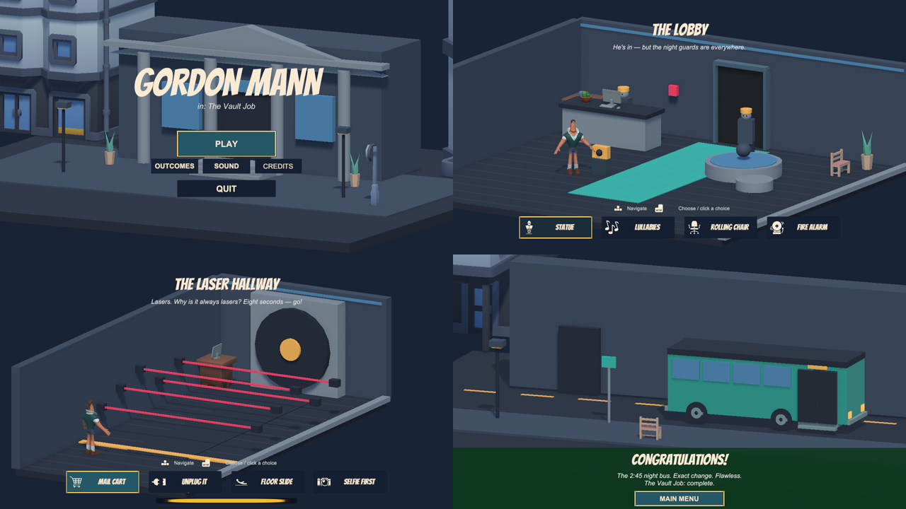

# Gordon Mann and The Heist

A comedy heist game about getting Gordon into Blackwell Bank and back out again.

In **The Vault Job**, bad plans get their own failure scenes. Retry returns you to the choice that caused the mess.

## Download the Windows playtest

**[Download for Windows (64-bit)](https://github.com/D00225745/gordon-mann-and-the-heist/releases/download/playtest-2026-11-19/Gordon-Mann-and-The-Heist-Windows-x64-2026-11-19.zip)** · [Release notes](https://github.com/D00225745/gordon-mann-and-the-heist/releases/tag/playtest-2026-11-19)

Extract the entire ZIP, then run **Gordon Mann.exe** from the extracted folder. Unity is not required.

## Current state

- Five decision scenes, thirteen failure scenes, and a successful escape.
- Animated sequences, sound effects, and a retry system.
- An outcomes gallery that remembers discoveries.
- Mouse and keyboard controls, controller navigation, and sound settings.

The game is in development. The environments, character animation, and presentation are still being refined.

## Open the project

1. Open this folder in Unity **6000.5.4f1**.
2. Choose **Tools → Scene Builder → Open Vault Job Blockout**.
3. Press **Play**.

Use the mouse to choose an option, or navigate with the arrow keys and confirm with Enter.

To make a Windows build, choose **Tools → Scene Builder → Build Gordon Mann Windows Playtest** and select a new output folder.

## Follow development

Watch this repository for updates. The [changelog](CHANGELOG.md) records the current playable state; issues can be used for bug reports and feedback.

## Assets and credits

Third-party assets retain their own licenses. See the [asset credits](Assets/Game/ThirdParty/CREDITS.txt) and the license files alongside the imported assets.

More detailed scene-editing notes are in [Assets/Game/README.md](Assets/Game/README.md). Scene rebuilding tools can overwrite manual edits, so edit the existing scenes when changing their sets or staging.
